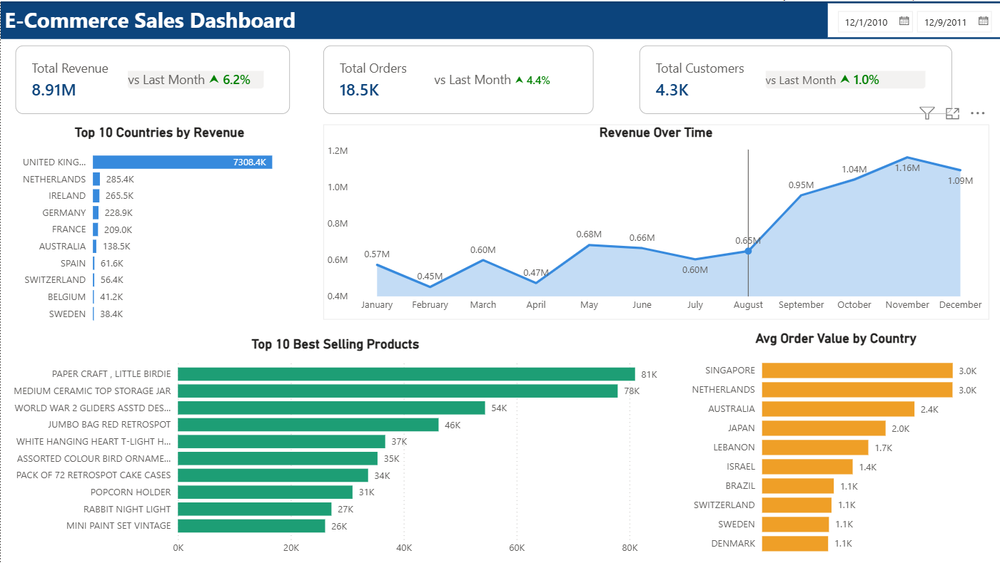

# E-Commerce Analytics Pipeline & Dashboard

An end-to-end data project: a tested Python ETL pipeline on e-commerce data in PostgreSQL, and a Power BI dashboard connected to the same database. Built with Python, PostgreSQL, and Power BI.



---

## What This Project Does

```
Raw CSV Data (UCI Online Retail)
    → PostgreSQL (table: clean_ecommerce)
        ├── → ETL Pipeline (Python): clean, validate, KPIs, export
        └── → Power BI Dashboard
```

The Python pipeline:

1. **Extracts** the e-commerce data from the `clean_ecommerce` table in PostgreSQL
2. **Cleans** it: standardizes column names, removes duplicate rows, fills missing values
3. **Validates** data quality (missing values, duplicates, negative revenue) and generates a report
4. **Calculates KPIs**: Revenue, Orders, Customers, Average Order Value, Top Country
5. **Exports** a timestamped cleaned CSV and a text report, with logging

The Power BI dashboard connects to the same PostgreSQL data and visualizes it.

---

## Dashboard Preview


The Power BI dashboard includes:

- **KPI Cards**: Total Revenue (£8.91M), Total Orders (18.5K), Total Customers (4.3K) with Month-over-Month % change
- **Revenue Over Time**: Monthly trend from Dec 2010 to Dec 2011
- **Top 10 Countries by Revenue**: United Kingdom dominates at £7.3M
- **Top 10 Best Selling Products**: by quantity sold
- **Average Order Value by Country**: Singapore and Netherlands lead at £3.0K

---

## Project Structure

```
ecommerce-automation-project/
├── etl_pipeline.py          # Main ETL pipeline
├── test_etl.py              # Unit tests (21 tests)
├── .env.example             # Environment variable template
├── .gitignore               # Ignores .env, exports, logs
├── requirements.txt         # Python dependencies
├── assets/
│   └── dashboard.png        # Dashboard screenshot
├── exports/                 # Auto-created on run
│   ├── cleaned_data_YYYYMMDD_HHMMSS.csv
│   └── data_report_YYYYMMDD_HHMMSS.txt
└── etl_log.log              # Auto-created on run
```

---

## Tech Stack

| Tool | Purpose |
|------|---------|
| Python 3.12 | Core pipeline language |
| Pandas | Data cleaning and transformation |
| Psycopg2 | PostgreSQL connection pooling |
| python-dotenv | Secure credential management |
| pytest | Unit testing (21 tests) |
| PostgreSQL | Data storage |
| Power BI | Interactive dashboard |

---

## Prerequisites

- Python 3.12
- PostgreSQL with a database (default name `ecomdb`) that contains a table called `clean_ecommerce`. This is the UCI Online Retail data after initial cleaning.
- Power BI Desktop (only to open the dashboard)
- clean_ecommerce is built from raw_ecommerce (the UCI Online Retail CSV imported as-is, [[raw row count]] rows) by keeping only rows with a customer ID, positive quantity and positive unit price, standardising country names (trimmed, upper-cased, EIRE to IRELAND), and adding a revenue column (quantity × unit price). This leaves 397,880 rows.

---

## Setup & Installation

### 1. Clone the repository

```bash
git clone https://github.com/codewithpatil-droid/ecommerce-automation-project.git
cd ecommerce-automation-project
```

### 2. Create and activate a virtual environment (recommended)

```bash
python -m venv venv
venv\Scripts\activate          # Windows
source venv/bin/activate       # Mac / Linux
```

### 3. Install dependencies

```bash
pip install -r requirements.txt
```

### 4. Configure environment variables

```bash
copy .env.example .env         # Windows
cp .env.example .env           # Mac / Linux
```

Edit `.env` with your database credentials:

```env
DB_NAME=ecomdb
DB_USER=postgres
DB_PASSWORD=your_password_here
DB_HOST=localhost
DB_PORT=5433
```

> Never commit your `.env` file. It is already listed in `.gitignore`.

### 5. Run the pipeline

```bash
python etl_pipeline.py
```

### 6. Run the tests

```bash
pytest test_etl.py -v
```

Expected output:
```
21 passed in Xs
```

---

## Pipeline Output

**Console log (from a real run):**
```
2026-11-24 15:30:56 - __main__ - INFO - ETL PIPELINE STARTED
2026-11-24 15:30:57 - __main__ - INFO - Database connection pool initialized
2026-11-24 15:30:59 - __main__ - INFO - Data fetched successfully: 397880 rows, 9 columns
2026-11-24 15:30:59 - __main__ - INFO - Starting data cleaning
2026-11-24 15:31:00 - __main__ - INFO - Removed 5192 duplicate rows
2026-11-24 15:31:00 - __main__ - INFO - Data cleaning completed: 397880 -> 392688 rows (5192 rows removed)
2026-11-24 15:31:00 - __main__ - INFO - Starting data validation
2026-11-24 15:31:01 - __main__ - INFO - Data validation completed
2026-11-24 15:31:01 - __main__ - INFO - KPI calculation completed: 5 KPIs calculated
2026-11-24 15:31:04 - __main__ - INFO - Cleaned data saved: exports\cleaned_data_20261124_153101.csv (392688 rows)
2026-11-24 15:31:04 - __main__ - INFO - Report saved successfully: exports\data_report_20261124_153104.txt
2026-11-24 15:31:04 - __main__ - INFO - ETL PIPELINE COMPLETED SUCCESSFULLY
2026-11-24 15:31:04 - __main__ - INFO - Database connection pool closed
```

**KPI report (from `exports/data_report_*.txt`):**
```
============================================================
BUSINESS KPIs
============================================================
Total Revenue:         8887208.89
Total Orders:          18532
Total Customers:       4338
Average Order Value:   479.56
Top Country:           United Kingdom
```

---

## Configuration Reference

| Variable | Default | Description |
|----------|---------|-------------|
| `DB_NAME` | `ecomdb` | PostgreSQL database name |
| `DB_USER` | `postgres` | Database username |
| `DB_PASSWORD` | `your_password_here` | Database password |
| `DB_HOST` | `localhost` | Database host |
| `DB_PORT` | `5433` | Database port |

---

## Dataset

Source: [UCI Online Retail Dataset](https://archive.ics.uci.edu/dataset/352/online+retail)
Period: December 2010 to December 2011
Records: 397,880 transactions in the `clean_ecommerce` table (392,688 after the pipeline removes exact duplicate rows)
Region: UK-based e-commerce retailer
Currency: GBP (£)

---

## Known Limitations

- Validation logs warnings but does not stop the pipeline when data quality is poor.
- The pipeline reads from an existing `clean_ecommerce` table; loading the raw CSV into PostgreSQL is done outside this script.
- The pipeline removes exact duplicate rows, while the Power BI dashboard reads the table before that step, so totals can differ slightly between the two.
- pandas shows a `UserWarning` because the pipeline uses a raw `psycopg2` connection instead of SQLAlchemy.

---

## Author

Babasaheb Patil
Email: babasahebpatil271@gmail.com
LinkedIn: https://www.linkedin.com/in/babasaheb-patil-5004aa36a
GitHub: https://github.com/codewithpatil-droid
